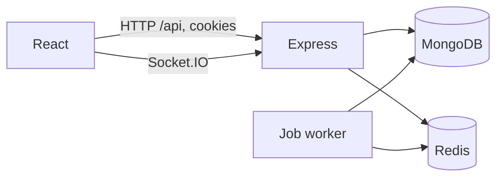

# TeamFlow

TeamFlow is a multi-tenant project tracker. An organization has members, projects, and a kanban board. A person can belong to more than one organization, and a request only returns data for the organization named in that request.

It is a MERN app: React and Vite on the client, Express and MongoDB on the server, with Redis used for rate limits, a short dashboard cache, and background jobs.

## What you can do

- Register, log in, log out, refresh a session, verify email, reset a password
- Create an organization, invite people, change roles, leave
- Create and archive projects, add project members, add labels
- Create tasks, move them on a board, comment, attach a file
- See activity, notifications, search, and a simple dashboard

Roles are owner, admin, manager, member, and viewer. The UI hides buttons the role cannot use. The API is what actually enforces it.

## How it fits together



The browser talks to `/api` with cookies. In development, Vite proxies that to the API, so the page and the API look like the same origin. Socket.IO uses the same proxy.

Every organization-scoped route reads `X-Organization-Id`, checks that the logged-in user is a member, and then every query includes that organization id. A task id from another organization does not match, so the API returns 404.

## Stack

- React, TypeScript, Vite, React Router, TanStack Query, Tailwind, React Hook Form, Zod, Axios, Socket.IO
- Node, Express, MongoDB, Mongoose, Redis, BullMQ, JWT in HTTP-only cookies
- Docker Compose, GitHub Actions

## Layout

```
client/src          pages, the board, the shell
server/src
  config/           env, Mongo, Redis, logger
  models/           Mongoose schemas
  routes/           URL map
  controllers/      read the request, call a service, send JSON
  services/         rules and database queries
  middleware/       auth, tenant, permission, errors
  permissions/      role to permission map
  sockets/          project rooms
  jobs/             email queue and due-date scan
  validators/       Zod schemas
```

There is no separate repository layer. Services own the queries. A second wrapper around Mongoose would not change the behavior.

## Data

Users are global. Everything else that belongs to a company stores `organizationId`.

| Collection | Why it is its own collection |
| --- | --- |
| Organization, OrganizationMember | membership is many-to-many, with a role |
| Invitation | the raw token is emailed, only the hash is stored |
| Project, ProjectMember, Label | a project is shared by a subset of the org |
| Task | the board is a query on project + status |
| Comment, Attachment, Activity | they grow on their own and are not embedded in the task |
| Notification | one user's inbox |
| RefreshToken, EmailToken | hashed secrets, with a TTL index |

Labels are a small collection per project, not free-form strings only, so the same name cannot be added twice. Task documents store the label names they use, which is enough for the board.

Projects and tasks are soft-deleted with `deletedAt`. Archive is a project status, not a delete.

Indexes that match the real queries:

- unique `{ organizationId, userId }` on members
- unique `{ projectId, userId }` on project members
- `{ organizationId, projectId, deletedAt, status, position }` on tasks
- `{ userId, read, createdAt }` on notifications

## Run it locally

You need Node 22, MongoDB, and Redis.

```bash
cp .env.example server/.env
# edit the two JWT secrets

docker compose up mongo redis -d
npm install
npm install --prefix server
npm install --prefix client
npm run dev
```

API on port 4000, UI on port 5173.

Seed a demo organization:

```bash
npm run seed
```

Log in as `asha@teamflow.dev` / `password123`. Same password for `ravi@teamflow.dev` and `nia@teamflow.dev`.

If SMTP is not set, invite and reset links are printed in the API log. That is intentional for local development.

## Docker

`docker compose up --build` starts MongoDB, Redis, the API, and an nginx container that serves the UI on port 8080 and proxies `/api` and `/socket.io`.

The compose file uses development secrets and `http://localhost:8080`. Cookies are marked `Secure` only when `CLIENT_URL` is `https`, so this local HTTP setup still works. Change the secrets before you put it anywhere public.

## Environment

See `.env.example`. The API refuses to boot if `MONGODB_URI` or the JWT secrets are missing. Secrets shorter than 16 characters are rejected.

Do not commit `server/.env`. Do not log passwords, cookies, or reset tokens. The logger is configured to redact those fields. In development, the full email body is logged only because that is how you get the link without SMTP.

## API

Responses look like `{ data }` or `{ error: { message } }`. List routes add `meta` with `page`, `limit`, and `total`.

| Method | Path | What it does |
| --- | --- | --- |
| POST | `/api/auth/register` | create account, set cookies |
| POST | `/api/auth/login` | log in |
| POST | `/api/auth/logout` | revoke the refresh token |
| POST | `/api/auth/refresh` | rotate the refresh token |
| GET | `/api/auth/me` | current user |
| POST | `/api/auth/forgot-password` | always 200 |
| POST | `/api/auth/reset-password` | set a new password |
| GET | `/api/organizations` | organizations for the current user |
| POST | `/api/organizations` | create one, caller becomes owner |
| GET | `/api/projects` | projects in the active organization |
| POST | `/api/projects/:projectId/tasks` | create a task |
| PATCH | `/api/tasks/:taskId` | update or move a task |
| GET | `/api/tasks/:taskId` | task, comments, activity, files |
| GET | `/api/notifications` | inbox |
| GET | `/api/dashboard` | counts for the active organization |
| GET | `/api/search?q=` | projects, tasks, members |

Organization routes need two things besides the cookie:

- `X-Teamflow-Client: web` on any request that is not a GET. A plain form post from another site will not set it.
- `X-Organization-Id` for anything inside an organization.

Example of the check people ask about in interviews. User B asks for user A's task:

1. No cookie: 401.
2. Cookie, but header is user B's organization: the task query includes that organization id, so the task is not found, 404.
3. Cookie, and header is user A's organization: user B is not a member, 403.

The handler is `requireOrg` in `server/src/middleware/tenant.ts`. The query is in `loadTask` in `server/src/services/task.service.ts`.

## Auth

Access token cookie, 15 minutes. Refresh token cookie, 7 days. Both are HTTP-only. The refresh token in the database is a SHA-256 hash. Refresh deletes the old row and writes a new one. Logout deletes the row. Reset password deletes every refresh token for that user.

Passwords are hashed with bcrypt. Forgot-password returns the same response whether or not the email exists.

## Realtime

The board emits `join:project` after the socket handshake. The handshake only accepts a valid access-token cookie, and the room join checks organization membership and project access. Task changes emit `task:changed` to that room. The client refreshes the task query. The person who dragged the card also updates their own cache immediately, then reconciles when the request finishes. If two people move the same card, the second save can get 409 because the client sends `updatedAt`.

## Redis

- Login and register: `INCR` a key per IP, 20 tries per 15 minutes. If Redis is down, the same limit is kept in memory for that process.
- Dashboard: cached for 30 seconds, deleted when a project or task changes.
- BullMQ: invitation and reset mail, plus a scan every 15 minutes for tasks due within a day. The due-date flag is set before the notification is written, so a retry does not send it twice.

If Redis is not running, the API still starts. Mail is delivered inline, which in development means it is logged. Caching and the repeating reminder do not run.

## Tests

```bash
npm test
```

Server tests cover the permission map and the cross-organization task read. They use an in-memory MongoDB. Client tests cover the permission helper and the login form.

## CI

GitHub Actions installs, lints, typechecks, tests, and builds the server and the client on Node 22.

## Deploy

Build the images from `docker-compose.yml`, point `MONGODB_URI` and `REDIS_URL` at real services, set long random JWT secrets, set `CLIENT_URL` to the public `https` origin, and configure SMTP if you want real email. Put the site behind HTTPS so the `Secure` cookie flag turns on. Uploaded files live on disk under `UPLOAD_DIR`. For more than one API instance, move that directory to object storage. Socket.IO and BullMQ already sit on Redis, which is what you need before running a second API process. This repo does not ship a multi-server Socket.IO adapter yet.

## Not in this version

- Reordering cards inside a column. A move between columns appends the card to the end of the new column.
- Detecting a reused refresh token after rotation. Rotation itself is in place.
- A shared package for the permission map. The server map is the one that matters. The client copy only hides buttons.
- Mongo transactions. Activity is written after the task save. If you run a replica set later, those two writes can share a session.
